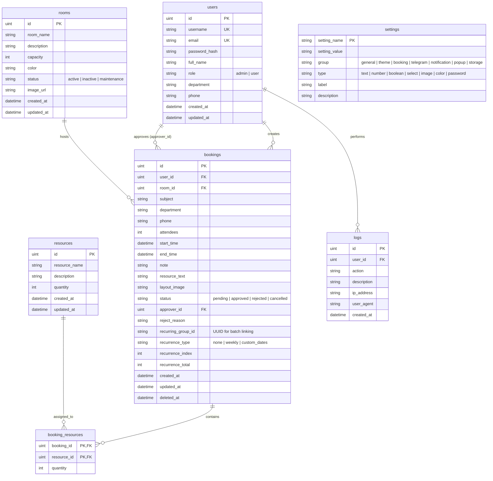

# ข้อกำหนดและรายละเอียดเชิงเทคนิคของระบบ (System Specification)
## TUNorth-BRMS: ระบบจองห้องประชุมและทรัพยากร (Booking & Resource Management System)

เอกสารนี้ระบุรายละเอียดข้อกำหนด สถาปัตยกรรมระบบ ฐานข้อมูล และ API ทั้งหมดของระบบ **TUNorth-BRMS** สำหรับโรงเรียนเตรียมอุดมศึกษาภาคเหนือ (Triam Udom Suksa School of the North)

---

## 1. ภาพรวมของระบบ (System Overview)

**TUNorth-BRMS** เป็นระบบเว็บแอปพลิเคชันสำหรับบริหารจัดการการจองห้องประชุมและอุปกรณ์สนับสนุนการประชุมแบบครบวงจร พัฒนาขึ้นเพื่อทดแทนกระบวนการจองแบบเอกสารเดิม เพิ่มความสะดวกรวดเร็ว ตรวจสอบความพร้อมของห้องแบบเรียลไทม์ และป้องกันการจองเวลาซ้ำซ้อน

### เป้าหมายหลัก (Core Objectives)
1. **ปฏิทินกลางแบบเรียลไทม์ (Centralized Real-Time Calendar):** แสดงสถานะการใช้งานห้องประชุมทุกห้องผ่านมุมมองปฏิทินแบบ Interactive
2. **รูปแบบการจองที่ยืดหยุ่น (Flexible Booking Modes):** รองรับทั้งการจองครั้งเดียว (Single), จองซ้ำรายสัปดาห์ (Weekly Recurring), และการเลือกหลายวันเวลาเดียวกัน (Custom Multi-Dates)
3. **ระบบตรวจสอบและจัดการเวลาชนอัจฉริยะ (Smart Conflict & Partial Conflict Handling):** แจ้งเตือนวัน/เวลาที่ห้องไม่ว่าง พร้อมตัวเลือกยืนยันจองเฉพาะวันที่ห้องว่างได้ทันที
4. **กระบวนการอนุมัติที่ปรับแต่งได้ (Flexible Approval Workflow):** รองรับทั้งการอนุมัติอัตโนมัติ (Auto-Approve) และการพิจารณาโดยผู้ดูแลระบบ (Admin Approval) แบบรายวันหรือทั้งชุด
5. **การแจ้งเตือนทันทีผ่าน Telegram (Real-Time Telegram Alerts):** แจ้งเตือนแอดมินเมื่อมีคำขอใหม่ และแจ้งเตือนผู้จองเมื่อสถานะเปลี่ยนแปลง โดยมีระบบ Anti-Spam รวบรวมข้อความสำหรับการจองแบบชุด
6. **การจัดการแบบไดนามิก (Dynamic System Configuration):** ปรับแต่งชื่อระบบ, โลโก้, สีธีม, ข้อกำหนดล่วงหน้า, วันหยุดเสาร์-อาทิตย์ ผ่านหน้า Admin Settings โดยไม่ต้องแก้โค้ด

---

## 2. สถาปัตยกรรมระบบและเทคโนโลยี (System Architecture & Tech Stack)

ระบบถูกออกแบบตามหลักการ **Hexagonal Architecture (Ports and Adapters)** ฝั่ง Backend เพื่อแยก Business Logic ออกจาก Framework และ Storage อย่างชัดเจน

```
┌─────────────────────────────────────────────────────────────┐
│                       Client Layer                          │
│        Next.js 16 (App Router, React 19, TypeScript)        │
│          Tailwind CSS 4, FullCalendar, Lucide Icons         │
└──────────────────────────────┬──────────────────────────────┘
                               │ HTTPS / REST API / JSON
┌──────────────────────────────▼──────────────────────────────┐
│                  Backend: Adapter (HTTP)                    │
│            Go 1.25 + Fiber v2 + JWT Middleware              │
├─────────────────────────────────────────────────────────────┤
│                  Core: Ports & Services                     │
│    BookingService, RoomService, UserService, SettingService │
│          NotificationService, LogService, ReportService     │
├─────────────────────────────────────────────────────────────┤
│                 Core: Domain Entities                       │
│    User, Room, Booking, BookingResource, Resource, Setting  │
├─────────────────────────────────────────────────────────────┤
│                 Adapter: Storage & External                 │
│      GORM + PostgreSQL (Supabase / Containerized DB)        │
│      Cloudinary Adapter (Image Uploads)                     │
│      Telegram Bot API Adapter (Notifications)               │
└─────────────────────────────────────────────────────────────┘
```

### รายการเทคโนโลยีหลัก
* **Backend:**
  * ภาษา: Go (v1.25+)
  * Web Framework: Go Fiber v2 (`github.com/gofiber/fiber/v2`)
  * ORM: GORM v1.31 (`gorm.io/gorm`, `gorm.io/driver/postgres`)
  * Authentication: JWT (`github.com/golang-jwt/jwt/v5`, `@gofiber/contrib/jwt`)
  * Password Hashing: Bcrypt (`golang.org/x/crypto/bcrypt`)
  * External Integrations: Cloudinary SDK, Telegram Bot API
* **Frontend:**
  * Framework: Next.js 16 (App Router)
  * UI Library: React 19, TypeScript 5
  * Styling: Tailwind CSS 4, Lucide React, Sonner (Toaster)
  * Calendar Engine: FullCalendar v6 (DayGrid, TimeGrid, Interaction, List)
  * State Management: Zustand (Auth Store)
* **DevOps & Infrastructure:**
  * Containerization: Docker & Docker Compose
  * Web Server / Reverse Proxy: Docker network (`tunorth-net`)
  * Database: PostgreSQL 15+

---

## 3. แบบจำลองข้อมูลและฐานข้อมูล (Database Schema & Entities)



---

## 4. ข้อกำหนดเชิงฟังก์ชัน (Functional Specifications)

### 4.1 ระบบยืนยันตัวตนและการจัดการสิทธิ์ (Authentication & Authorization)
* **การลงทะเบียนและเข้าสู่ระบบ:** ใช้ JWT Token แนบใน Header `Authorization: Bearer <token>`
* **Role-Based Access Control (RBAC):**
  * `user`: ดูปฏิทิน, จองห้องประชุม, ตรวจสอบสถานะการจองของตนเอง, แก้ไข/ยกเลิกการจองของตนเอง
  * `admin`: มีสิทธิ์ทั้งหมดของ user ร่วมกับ การอนุมัติ/ปฏิเสธการจอง, จัดการห้องประชุม, จัดการอุปกรณ์, บริหารจัดการผู้ใช้งาน (เพิ่ม/แก้ไข/ลบ/นำเข้า CSV), ดูรายงานสถิติ, ดู Audit Logs, และแก้ไขการตั้งค่าระบบทั้งหมด

### 4.2 ระบบการจองห้องประชุม (Booking Engine)
1. **โหมดการจอง 3 รูปแบบ:**
   * **Single Date (ครั้งเดียว):** ระบุวัน-เวลาเริ่มต้น และ วัน-เวลาสิ้นสุด (ต่อเนื่องกัน)
   * **Weekly Recurring (จองซ้ำรายสัปดาห์):** กำหนดวันเริ่มต้น, จำนวนสัปดาห์ (สูงสุดตาม `max_recurring_count`), เวลาเริ่ม-สิ้นสุด
   * **Custom Multi-Dates (หลายวันเวลาเดียวกัน):** กำหนดช่วงเวลา 1 ครั้ง และเลือกวันที่ได้หลายๆ วันแบบยืดหยุ่น
2. **การตรวจสอบความพร้อมและข้อขัดแย้ง (Conflict Checking):**
   * เวลาเริ่มต้นต้องมาก่อนเวลาสิ้นสุด (`start_time < end_time`)
   * ห้องต้องมีสถานะเป็น `active`
   * ตรวจสอบเงื่อนไข `advance_booking_days` (จองล่วงหน้ากี่วัน โดย Admin ได้รับการยกเว้น)
   * ตรวจสอบเงื่อนไข `allow_weekend` (หากเป็น false จะไม่อนุญาตให้จองวันเสาร์-อาทิตย์)
   * ตรวจสอบการทับซ้อนของช่วงเวลาห้องผ่าน SQL:
     ```sql
     WHERE room_id = ? 
       AND LOWER(status) NOT IN ('cancelled', 'rejected') 
       AND start_time < ? 
       AND end_time > ?
     ```
3. **ระบบ Partial Conflict Confirmation:**
   * หากเลือกจองแบบชุด เช่น 6 สัปดาห์ แต่สัปดาห์ที่ 3 ไม่ว่าง ระบบจะระบุวันที่มีปัญหา พร้อมปุ่ม **"เลือกเฉพาะวันที่ว่าง"** ให้ผู้ใช้กดยืนยันจองเฉพาะวันที่ว่างได้ทันที
4. **การอนุมัติอัตโนมัติ (Auto-Approval) หรือผ่านผู้ดูแล:**
   * หากตั้งค่า `default_booking_status` เป็น `approved` รายการทั้งหมดจะได้รับการอนุมัติอัตโนมัติทันที
   * หากตั้งเป็น `pending` แอดมินสามารถเลือก:
     * อนุมัติเฉพาะรายการนี้ (`Check`)
     * อนุมัติทุกรายการในชุดนี้ (`CheckCheck`)
     * ไม่อนุมัติเฉพาะรายการนี้ (`X`)
5. **การยกเลิกและการลบ (Cancellation Scope):**
   * สำหรับการจองที่เป็นชุด เมื่อกดยกเลิกหรือลบ จะมี Dialog ให้เลือกระหว่าง:
     * "ยกเลิกเฉพาะรายการวันนี้"
     * "ยกเลิกทุกรายการในชุดนี้"

### 4.3 การแจ้งเตือนผ่าน Telegram (Notification Service)
* **แจ้งเตือนแอดมินเมื่อมีรายการจองใหม่:**
  * หากเป็น Single Booking: ส่งรายละเอียดวัน เวลา ห้อง และผู้จอง
  * หากเป็น Recurring Booking (ชุด): ส่งสรุปเพียง 1 ข้อความ ระบุจำนวนครั้งทั้งหมด วันที่ทั้งหมด และสถานะ (ป้องกันการแจ้งเตือนสแปม)
* **แจ้งเตือนผู้ใช้เมื่อสถานะเปลี่ยน:** ส่งข้อความแจ้งเมื่อรายการได้รับการอนุมัติหรือไม่อนุมัติ

### 4.4 การตั้งค่าระบบแบบไดนามิก (Dynamic System Settings)
รองรับการปรับแต่งค่าผ่าน UI โดยไม่ต้อง Deploy ใหม่:
* **ทั่วไป (General):** ชื่อระบบ (`site_name`), คำอธิบาย (`site_description`), ชื่อสถาบัน (`institute_name`), เปิด/ปิดการสมัครสมาชิก (`enable_register`)
* **ธีม (Theme):** สีธีมหลัก (`theme_color`), สีธีมรอง (`theme_color_secondary`), สีพื้นหลัง Gradient
* **การจอง (Booking):** สถานะเริ่มต้น (`default_booking_status`), วันจองล่วงหน้า (`advance_booking_days`), อนุญาตวันหยุด (`allow_weekend`), จำนวนจองซ้ำสูงสุด (`max_recurring_count`)
* **Telegram:** Token บอท, Admin Chat ID, User Chat ID
* **Storage:** Cloudinary Cloud Name, API Key, API Secret (หากไม่ตั้งจะ Fallback ใช้ Local Storage ใน `/uploads`)

---

## 5. ข้อกำหนดรายละเอียด API (API Endpoints Specification)

### 5.1 หมวดหมู่การยืนยันตัวตน (Authentication)
| Method | Endpoint | สิทธิ์ | คำอธิบาย |
|---|---|---|---|
| `POST` | `/api/register` | Public | ลงทะเบียนสมาชิกใหม่ (หาก `enable_register=true`) |
| `POST` | `/api/login` | Public | เข้าสู่ระบบ คืนค่า JWT Token และ User Profile |
| `GET` | `/api/me` | User, Admin | ดูข้อมูลส่วนตัวของผู้ใช้งานปัจจุบัน |
| `PUT` | `/api/me` | User, Admin | อัปเดตข้อมูลส่วนตัว (ชื่อ, รหัสผ่าน, เบอร์โทร) |

### 5.2 หมวดหมู่การจอง (Bookings)
| Method | Endpoint | สิทธิ์ | คำอธิบาย |
|---|---|---|---|
| `GET` | `/api/bookings` | Public/Auth | ดึงข้อมูลการจอง (รองรับ query `?start=...&end=...` และ `?user_id=...`) |
| `POST` | `/api/bookings` | User, Admin | สร้างการจองแบบครั้งเดียว (รองรับ Multipart Form Data พร้อมรูปผัง) |
| `POST` | `/api/bookings/check-conflicts` | User, Admin | ตรวจสอบความพร้อมของรายการช่วงเวลา (Pre-check Conflict) |
| `POST` | `/api/bookings/recurring` | User, Admin | สร้างการจองแบบชุด (Recurring/Multi-Date) ใน Transaction เดียว |
| `PATCH` | `/api/bookings/:id/status` | Admin | อัปเดตสถานะการจองรายการเดี่ยว (`approved`, `rejected`) |
| `PATCH` | `/api/bookings/group/:groupId/status` | Admin | อัปเดตสถานะการจองทั้งชุดตาม Recurring Group ID |
| `PUT` | `/api/bookings/:id` | Owner, Admin | แก้ไขรายละเอียดการจอง |
| `DELETE` | `/api/bookings/:id` | Owner, Admin | ลบ/ยกเลิกการจองรายการเดี่ยว |
| `DELETE` | `/api/bookings/group/:groupId` | Owner, Admin | ลบ/ยกเลิกการจองทั้งชุดตาม Recurring Group ID |

### 5.3 หมวดหมู่ห้องประชุม (Rooms)
| Method | Endpoint | สิทธิ์ | คำอธิบาย |
|---|---|---|---|
| `GET` | `/api/rooms` | Public | ดึงรายการห้องประชุมทั้งหมด (รองรับ `?status=active`) |
| `GET` | `/api/rooms/:id` | Public | ดึงรายละเอียดห้องประชุมรายห้อง |
| `POST` | `/api/rooms` | Admin | เพิ่มห้องประชุมใหม่ |
| `PUT` | `/api/rooms/:id` | Admin | แก้ไขข้อมูลห้องประชุม |
| `DELETE` | `/api/rooms/:id` | Admin | ลบห้องประชุม |

### 5.4 หมวดหมู่การตั้งค่า (Settings)
| Method | Endpoint | สิทธิ์ | คำอธิบาย |
|---|---|---|---|
| `GET` | `/api/settings/public` | Public | ดึงค่าตั้งค่าระบบที่ปลอดภัย (Whitelist) สำหรับแสดงผลหน้าบ้าน |
| `GET` | `/api/settings` | Admin | ดึงค่าตั้งค่าทั้งหมดสำหรับหน้า Admin Settings |
| `PUT` | `/api/settings` | Admin | อัปเดตค่าตั้งค่าระบบ |
| `POST` | `/api/settings/upload` | Admin | อัปโหลดรูปภาพโลโก้/Popup เข้าสู่ระบบ |

### 5.5 หมวดหมู่รายงานและบันทึกการใช้งาน (Reports & Audit Logs)
| Method | Endpoint | สิทธิ์ | คำอธิบาย |
|---|---|---|---|
| `GET` | `/api/reports/dashboard` | Admin | สถิติภาพรวม ยอดการจอง สัดส่วนห้องที่ใช้ และแนวโน้มรายวัน |
| `GET` | `/api/logs` | Admin | บันทึกประวัติการกระทำในระบบ (Audit Logs) |

---

## 6. ข้อกำหนดเชิงคุณภาพและความปลอดภัย (Non-Functional Specifications)

1. **ความปลอดภัยของข้อมูล (Security):**
   * รหัสผ่านถูกเข้ารหัสด้วย Bcrypt Cost Factor 10+
   * ป้องกัน Insecure Direct Object References (IDOR): ผู้ใช้แก้ไขหรือลบได้เฉพาะการจองของตนเองเท่านั้น
   * Sanitized Settings Whitelist: ข้อมูลความลับ (Database Credentials, Telegram Token, Cloudinary Secret) จะไม่ถูกส่งผ่าน `/api/settings/public`
2. **ความสมบูรณ์ของการทำธุรกรรม (Transaction Integrity):**
   * การบันทึกชุดการจองหลายวัน (`CreateBatch`) ทำงานภายใต้ Database Transaction หากมีรายการใดผิดพลาดจะ Rollback ทั้งหมด
3. **การจัดการไฟล์อัปโหลด (File Handling):**
   * จำกัดขนาดไฟล์อัปโหลดสูงสุดไม่เกิน 20 MB (`BodyLimit: 20 * 1024 * 1024`)
   * รองรับทั้งการอัปโหลดผ่าน Cloudinary CDN และ Local Storage Volume
4. **ความเข้ากันได้และการแสดงผล (Responsive UI):**
   * รองรับการใช้งานทั้งบน Desktop, Tablet และ Mobile ผ่าน Responsive Design
